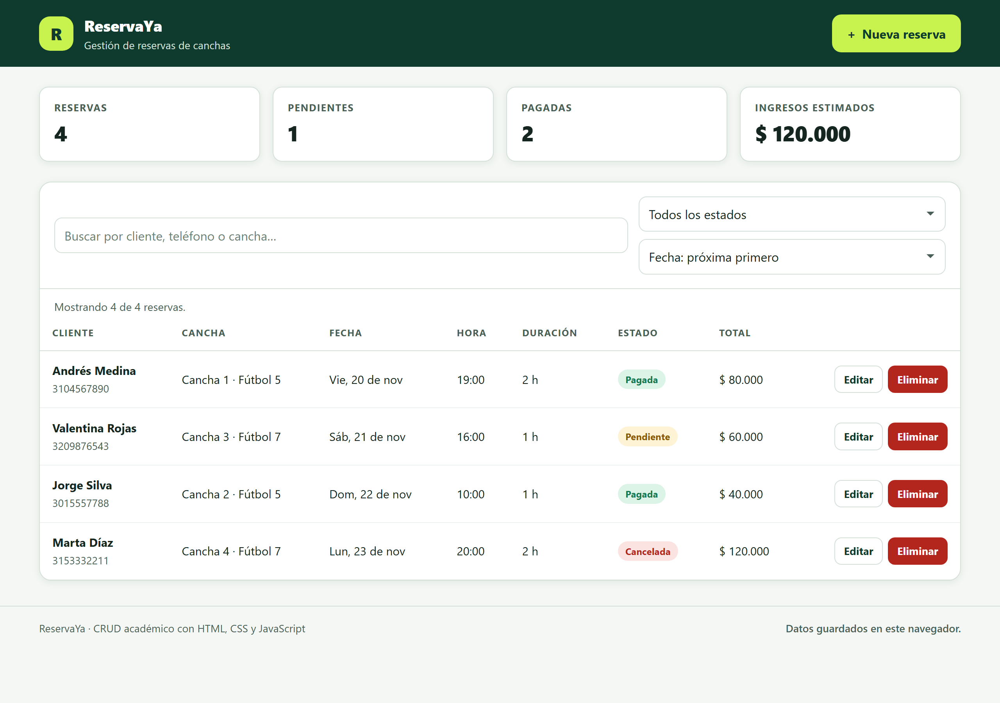
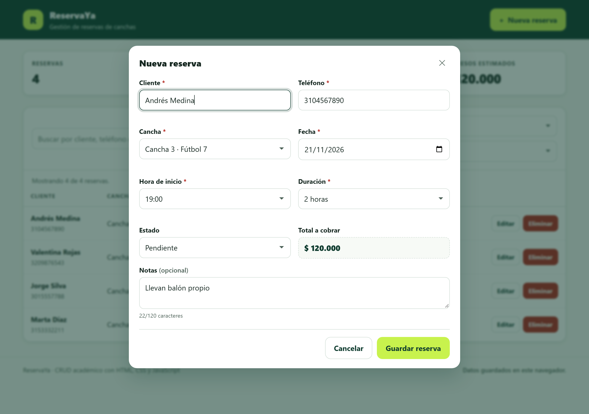
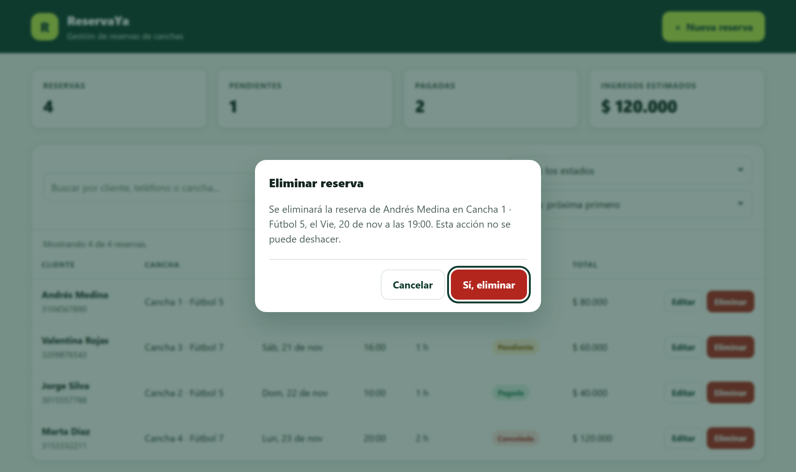
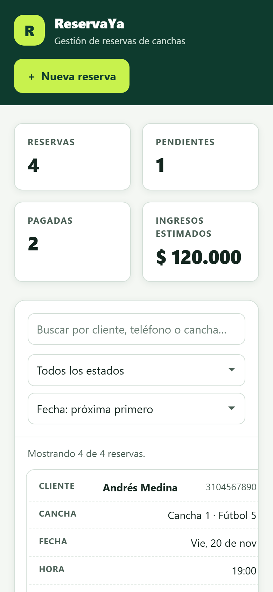
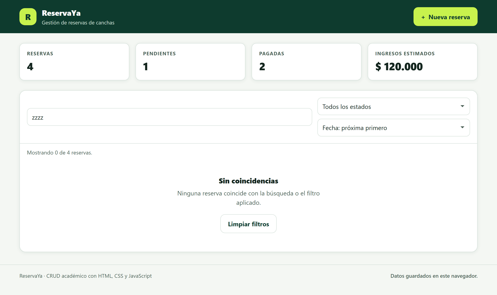

# ReservaYa · CRUD de reservas de canchas

Aplicación web para registrar, consultar, editar y eliminar reservas de canchas deportivas. Construida con HTML, CSS y JavaScript sin librerías, con persistencia en el navegador.

> Trabajo final del Seminario de Gestión de Software Ágil Asistido por IA.
> La idea del ejercicio: **la IA propone, el humano verifica**.

---

## 1. Nombre del proyecto

**ReservaYa** — gestión de reservas de canchas deportivas.

## 2. Descripción

ReservaYa resuelve un problema concreto de los barrios: hoy el turno de una cancha se cierra por WhatsApp con el administrador. El jugador no ve la disponibilidad real, escribe a tres o cuatro canchas y espera respuesta; cuando le contestan, el horario ya se ocupó.

La aplicación permite llevar ese registro en un solo lugar:

- **Crear** una reserva con cliente, teléfono, cancha, fecha, hora, duración y estado.
- **Consultar** el listado completo, con búsqueda por texto, filtro por estado y cuatro criterios de orden.
- **Actualizar** cualquier reserva desde un formulario que se abre precargado.
- **Eliminar** con confirmación previa, para que un clic accidental no borre nada.

Incluye validación de datos, detección de cruces de horario en la misma cancha, cálculo automático del total a cobrar y un resumen con indicadores.

## 3. Capturas de pantalla

**Vista principal** con el listado, los indicadores y la barra de filtros:



**Formulario de creación**, con validación y total calculado mientras se elige cancha y duración:



**Confirmación antes de eliminar**:



**Vista en móvil**: la tabla se convierte en tarjetas apiladas.



**Estado vacío** cuando la búsqueda no encuentra coincidencias:



## 4. Tecnologías utilizadas

| Tecnología | Uso en el proyecto |
|---|---|
| **HTML5** | Estructura semántica: `header`, `main`, `section`, `table`, `dialog` simulado con `role="dialog"`. |
| **CSS3** | Variables de color, Grid y Flexbox, diseño responsive, foco visible. Sin frameworks ni Tailwind. |
| **JavaScript (ES6+)** | Lógica de la aplicación: módulos por capas, manipulación del DOM, eventos y validación. Sin librerías ni dependencias externas. |
| **localStorage** | Persistencia de las reservas en el navegador, con respaldo en memoria si no está disponible. |
| **Intl** | Formato de moneda en pesos colombianos y de fechas en español. |

No hay servidor ni base de datos: el alcance del ejercicio lo permite y simplifica la ejecución.

## 5. Instrucciones para ejecutar el proyecto

**Opción A — abrir el archivo (lo más rápido)**

1. Descarga o clona el repositorio.
2. Haz doble clic en `index.html`.
3. Se abre en el navegador con cuatro reservas de ejemplo.

**Opción B — servidor local (recomendado si el navegador bloquea el almacenamiento)**

```bash
# desde la carpeta del proyecto
python -m http.server 8000
# y abre http://localhost:8000
```

También funciona publicado en GitHub Pages, porque son archivos estáticos.

**Para empezar de cero:** borra los datos del sitio desde las herramientas del navegador (Application → Local Storage) o ejecuta en la consola:

```js
localStorage.removeItem('reservaya.reservas.v1');
localStorage.removeItem('reservaya.semilla.v1');
location.reload();
```

## 6. Estructura del proyecto

```
.
├── index.html          Estructura y formularios
├── css/
│   └── styles.css      Todos los estilos y el diseño responsive
├── js/
│   ├── storage.js      Persistencia (localStorage con respaldo en memoria)
│   ├── reservas.js     Modelo: validación, reglas y CRUD
│   ├── ui.js           Interfaz: render, modales, eventos y avisos
│   └── app.js          Punto de entrada
├── docs/               Capturas de pantalla
└── README.md
```

La separación es deliberada: el modelo no toca el DOM y la interfaz no guarda datos. Así cada archivo se puede explicar por separado.

## 7. El CRUD, operación por operación

| Operación | Dónde está | Cómo funciona |
|---|---|---|
| **Create** | `Reservas.crear()` | Valida, verifica que no haya cruce de horario, asigna un id y persiste. |
| **Read** | `Reservas.consultar()` + `UI.render()` | Filtra por texto y estado, ordena y dibuja la tabla o el estado vacío. |
| **Update** | `Reservas.actualizar()` | Revalida contra las demás reservas (excluyéndose a sí misma) y reemplaza el registro. |
| **Delete** | `Reservas.eliminar()` | Pide confirmación en un modal y elimina por id. |

## 8. Reglas de negocio

1. **Una cancha no puede tener dos reservas cruzadas** en la misma fecha. Se comparan intervalos: una reserva de 09:00 a 11:00 choca con otra de 10:00 a 11:00.
2. **Una reserva cancelada libera el turno**, de modo que ese horario puede volver a reservarse.
3. **Ningún turno termina después de las 23:00.**
4. **La fecha no puede ser anterior a hoy.**
5. **El teléfono debe tener 10 dígitos.**
6. **El total se calcula solo**, según la tarifa de la cancha y la duración: fútbol 5 vale $40.000 la hora y fútbol 7, $60.000.

## 9. Decisiones de diseño

- **Tabla en escritorio, tarjetas en móvil.** Por debajo de 720 px la tabla se reordena con `data-etiqueta` y cada fila se convierte en una tarjeta legible.
- **Un solo formulario para crear y editar.** El título y el botón cambian según el modo; el campo oculto `id` decide si se crea o se actualiza.
- **Confirmación antes de borrar**, porque eliminar es irreversible.
- **Avisos con `aria-live`** para que la confirmación de cada acción llegue también a un lector de pantalla.
- **Foco visible y etiquetas en todos los campos**; los errores se anuncian con `role="alert"` junto al campo afectado.

## 10. Prompts utilizados

Registro de las instrucciones enviadas a la herramienta de IA durante el desarrollo, con lo que se pedía y para qué.

| # | Prompt enviado (resumen) | Qué pedí y para qué | Resultado |
|---|---|---|---|
| 1 | «Actúa como desarrollador frontend. Necesito un CRUD de reservas de canchas con HTML, CSS y JavaScript puro, sin librerías ni frameworks. Muéstrame la estructura de archivos antes de escribir código.» | Fijar el alcance y el stack desde el principio, y obligar a planear antes de codificar. | Propuso una estructura de cuatro archivos JS por capas. La acepté porque separa modelo e interfaz. |
| 2 | «Define la entidad reserva con: cliente, teléfono, cancha, fecha, hora, duración, estado y notas. Genera un id único que funcione también sin conexión.» | Tener el modelo de datos cerrado antes de la interfaz. | Usó `crypto.randomUUID()`; le pedí un respaldo manual porque no existe en navegadores antiguos. |
| 3 | «Valida el formulario en JavaScript: nombre de al menos 3 letras, teléfono de 10 dígitos, fecha no anterior a hoy y duración de 1 o 2 horas. Muestra el error debajo de cada campo y marca el campo con aria-invalid.» | Que los datos no lleguen sucios al modelo y que el error sea accesible. | Correcto, pero enfocaba el primer campo inválido solo si era el nombre; lo generalicé a cualquiera. |
| 4 | «Impide crear dos reservas que se crucen en la misma cancha y fecha. Compara intervalos, no solo horas exactas. Una reserva cancelada no debe bloquear el turno.» | Es la regla de negocio central de la aplicación. | Implementó la comparación de intervalos con `<` y `>`. La revisé con casos de 1 y 2 horas. |
| 5 | «Guarda las reservas en localStorage. Si localStorage no está disponible o falla, sigue funcionando en memoria y avísalo en el pie de página.» | Persistencia sin romper la demo en modo privado. | Añadió un respaldo en memoria y un indicador de estado. |
| 6 | «Maqueta el listado como tabla en escritorio y como tarjetas en móvil, sin duplicar el HTML. Usa los mismos datos.» | Evitar dos versiones del mismo listado. | Propuso `display:block` con `::before` y `data-etiqueta`. Funcionó; ajusté tamaños y alineación. |
| 7 | «Revisa la accesibilidad: etiquetas asociadas, `aria-live` en los avisos, foco visible y contraste mínimo de 4,5:1 en el texto.» | Cumplir lo trabajado en el módulo de interfaces. | Añadió `aria-live` y `role="alert"`; el contraste lo verifiqué yo par por par. |
| 8 | «Calcula el total según cancha y duración y muéstralo en el formulario mientras el usuario elige, sin recargar.» | Que el usuario vea el precio antes de guardar. | Lo implementó con un evento `change`; el campo mostraba $0 al abrir la edición y lo corregí llamando al cálculo al cargar. |
| 9 | «Separa el código por capas: persistencia, modelo y presentación. El modelo no debe tocar el DOM.» | Poder explicar cada parte en el video y facilitar el mantenimiento. | Reorganizó en `storage.js`, `reservas.js`, `ui.js` y `app.js`, que es la estructura final. |
| 10 | «Al eliminar una reserva el contador de la tabla no baja. Revisa si el evento se está disparando y dime por qué antes de cambiar nada.» | Depurar un comportamiento raro durante las pruebas. | Explicó el flujo, pero la causa estaba en mi prueba, no en el código: había creado una reserva extra sin darme cuenta. Lo confirmé midiendo los registros guardados. |

## 11. Qué ajusté a mano sobre lo que propuso la IA

- **Respaldo de `crypto.randomUUID()`**: el navegador puede no tenerlo; añadí generación manual.
- **Cálculo del total al editar**: se mostraba $0 porque solo se actualizaba con `change`. Ahora se llama al abrir el formulario.
- **Foco en el primer campo inválido**: se generalizó para cualquier campo, no solo el nombre.
- **Estilos**: la IA propuso una paleta azul genérica; la cambié por la de ReservaYa y verifiqué el contraste de cada par.
- **Mensajes**: reescribí los textos de error para que dijeran qué hacer y no solo qué falló.
- **Datos de ejemplo**: los hice relativos a la fecha de hoy para que la demo siempre muestre reservas futuras.

## 12. Autor

**Luis Armando Laureano Betancourth**
Fundación Escuela Tecnológica de Neiva Jesús Oviedo Pérez · Ingeniería de Software
luis_laureanobe@fet.edu.co

---

### Uso de IA

La aplicación se desarrolló con asistencia de un modelo de lenguaje: se le pidieron estructuras, validaciones y correcciones puntuales (ver la tabla de prompts). Todas las propuestas se revisaron, se probaron en el navegador y se ajustaron a mano. Las decisiones de diseño, la paleta, la verificación de contraste y las pruebas de aceptación son propias.
